# Inventário e fluxo de execução

O inventário refere-se a [`9db4f20c614a645a4949f88562d5054ec53b8181`](https://github.com/nunovinhas-creator/goal-roi/tree/9db4f20c614a645a4949f88562d5054ec53b8181). A árvore contém 278 ficheiros versionados. O histórico integral da referência tem 2 909 commits.

| Área | Ficheiros | Papel |
|---|---:|---|
| `scangoal/` | 30 | Recolha, mercados, evidência, decisão, publicação e estudos auxiliares. A análise da árvore sintática localizou 502 definições de função, incluindo funções internas e métodos. |
| `scripts/` | 25 | Autorização, despacho, observação, auditorias, ensaios, migração e verificações pós-integração. São 147 definições de função. |
| `data/` | 16 | Diários e estados de publicação, fontes de resultados, registo de hipóteses e relatório. |
| `docs/` | 5 | Interface estática, relatório JSON e exportação CSV. O Pages serve `main:/docs`. |
| `ops/` | 4 | Worker de continuidade, configuração Wrangler, testes e procedimento de validação. |
| `tests/` | 54 | 41 módulos Python e evidência de regressão, testes de navegador e fixtures. |
| `audits/` | 137 | Protocolos, cortes, reconciliações, estudos em sombra, capturas do website e provas históricas. São artefactos de revisões diferentes. |
| `.github/workflows/` | 4 | Recolha, continuidade, inicialização do orçamento AI e testes. |
| Raiz | 3 | README, `.gitignore` e duas dependências diretas em `requirements.txt`. |

## Percurso dos dados e dos efeitos

```mermaid
flowchart LR
    ScanGoal["ScanGoal"] --> Telegram["Telegram · conversa do bot"]
    Telegram --> Read["Telethon · leitura completa 400 e rápida 40"]
    Read --> Log["messages.jsonl · estado e janelas"]
    Read --> Backfill["Arquivo de lacunas · até 100 por página"]
    Log --> Parser["Parser · tipo, jogo, mercado, seleção, odd"]
    Parser --> Legacy["ROI e acerto históricos · ID bruto"]
    Parser --> Research["Identidade canónica e primeira decisão"]
    HL["Highlightly · FT e minutos"] --> FT["Snapshots e versões FT"]
    BSD["BSD · FT"] --> FT
    Parser --> FT
    FT --> Legacy
    FT --> Research
    Research --> Brain["Cérebro · hipóteses e walk-forward"]
    Research --> Audit["Auditoria e ranking Polymarket"]
    Brain --> Cert["Certificação · registo e teste sequencial"]
    Brain --> LLM["LLM opcional · autorização, conta e reserva Git"]
    Audit --> LLM
    LLM --> Registry["Registo de hipóteses e notas"]
    Registry --> Brain
    Legacy --> JSON["Relatório JSON e CSV"]
    Brain --> JSON
    Cert --> JSON
    JSON --> Pages["GitHub Pages · dashboard"]
    JSON --> Outbox["Notificador e estudo Polymarket"]
    Outbox --> Git["Intenção pré-envio em Git"]
    Git --> Target["Telegram · bot de saída"]
    Legacy --> Stake["Avisos Stake das leituras rápidas"]
    Stake --> Git
    Actions["GitHub Actions · main"] --> Read
    Actions --> HL
    Actions --> BSD
    Actions --> Actions
    Watchdog["Cloudflare · observação e guarda SQLite"] -.-> Actions
    Backfill -.-> Archive["Análise de lacunas fora do fluxo vivo"]
```

A leitura principal atualiza o registo de mensagens e a evidência da janela, consulta fornecedores, tenta o passo LLM se habilitado, gera o relatório, planeia avisos e faz a publicação final em Git. As leituras rápidas podem gerar e enviar avisos entre recolhas completas. A prioridade do marcador no histórico legado é mensagem do bot, nota isolada, Highlightly, BSD e resultado manual, com preenchimento adicional por minutos aos 90. O percurso de investigação usa identificação canónica e versões FT. Há exceções de compatibilidade para fontes legadas. O estudo Polymarket e o ranking reutilizam a função de liquidação do estudo e distinguem o preço fixado do preço mostrado num alerta. Os avisos Stake têm diário próprio. [Recolha](../../.github/workflows/collect.yml), [relatório](../../scangoal/report.py), [regras de versões](../../scangoal/opportunity_results.py), [estudo Polymarket](../../scangoal/opportunity_forward.py).

## Componentes de aplicação

| Ficheiro | Entrada, responsabilidade e dependência |
|---|---|
| `__init__.py` | Define o pacote Python usado por `python -m scangoal.…`. |
| `reader.py` | Abre sessão Telethon sem login interativo, lê a janela, regista IDs ausentes e avança um cursor de backfill. |
| `watch.py` | Reutiliza a sessão, agenda tentativas de leitura, atualiza a frescura e chama relatório, notificador e avisos Stake. |
| `store.py` | Resolve a pasta de dados e deduplica versões com ID da mensagem e SHA-256 do texto. |
| `parser.py` | Classifica Betfair, Stake, Polymarket, Open game, Totals Form, Goal brewing, alinhamento enfraquecido, notas FT e serviço. Normaliza a hora Moscovo para UTC e liquida mercados suportados. |
| `match_identity.py` | Fixa identidade por ordem de disponibilidade, compatibilidade de equipas e competição, hora e colisões. Liga IDs alternativos com evidência de jogo idêntico. |
| `eligibility.py` | Define identidade de jogo e aposta e filtros de proveniência, mercado e odd. |
| `chronology.py` | Separa hora do sinal, leitura, resultado e decisão. Constrói a vista temporal a partir de apostas já materializadas. |
| `freshness.py` | Limites de tempo pré-jogo e ao vivo e detetor de fim de jogo. Partilhado pelos avisos e por parte do cérebro. |
| `results_bsd.py` | Pagina resultados BSD, normaliza nomes, aplica aliases e reutiliza o ID da fonte para observar versões. Exporta utilitários usados pela Highlightly. |
| `results_hl.py` | Converte eventos Highlightly, aplica cadência e quota e regista ausências e estados fora dos 90 minutos. |
| `details_hl.py` | Consulta eventos de jogo, reconstrói golos e verifica consistência com o total final. |
| `opportunity_results.py` | Guarda e agrega observações simultâneas e edições FT com relógio e eventual conflito. |
| `report.py` | Carrega a primeira versão e os resultados, produz duas populações, agrupa apostas, calcula lucro e prepara JSON e CSV. |
| `insights.py` | Medidas exploratórias, votos por jogo, inferência Beta, intervalos Wilson, segmentos, regime, calibração e risco. |
| `brain.py` | Gera e avalia hipóteses, estados com histerese, quadro, agenda, percurso cronológico e teste de confirmação. |
| `certification.py` | Registo de seleção, orçamento alfa por rank, cadeia de hashes e inspeção do histórico Git. Ativação por comando explícito. |
| `equivalence.py` | Índice de condições por pertença, remoção de redundância exata e grupos de ligação completa por Jaccard. |
| `llm.py` | Monta vocabulário e prompt, submete a Workers AI após reserva, valida propostas e notas e grava metadados. |
| `llm_budget.py` | Guarda de quota num ref Git dedicado. Usa compare-and-swap e reserva pessimista no dia UTC. |
| `llm_eval.py` | Avaliação incremental pré-registada, controlos, agrupamento ao nascer, prova do Git, imputação e e-processo diário. |
| `notify.py` | Planeia, formata, verifica certificado e frescura, aplica deduplicação e reconcilia diário, intenção, envio e desfecho. |
| `stake_alerts.py` | Regra independente das três linhas Stake, diário próprio e reutilização do publicador de intenção Git. |
| `polymarket_alerts.py` | Regra fixa pré-jogo Over 2,5 em mercado de golos regulamentares e fronteira de ativação. Alimenta o notificador geral. |
| `opportunity_forward.py` | Estudo congelado Polymarket, primeira cotação elegível por jogo, prazo de resolução e resultados de reconciliação. |
| `opportunity_ranking.py` | Compara a mesma regra com população mais ampla e sobreposta. Penalização descritiva por dia e controlo de concentração. |
| `betfair_audit.py` | Inventário Betfair, inspeção de snapshots, cobertura de resultados e análise de sensibilidade. Ferramenta de auditoria. |
| `betfair_reconcile.py` | Verifica manifestos, compara inventários fixados e classifica casos pendentes com evidência conservada. |
| `shadow.py` | Estudo Open game em sombra, protocolo, diário de eventos, medições e análise sequencial. |
| `shadow_ops.py` | Publicação isolada do estudo, recibos remotos Git, captura congelada e exportação e recuperação da caixa de saída. Ramo e autorização próprios. |

## Entradas operacionais e ferramentas

| Entrada | Ligação e alcance |
|---|---|
| `collect.yml` | Cron UTC de dez em dez minutos e despacho manual. Grupo `scangoal-write`, limite de 18 minutos, autorização Telegram de entrada separada da de saída. A etapa de despacho deixa sucessor. |
| `continuity.yml` | Observador GitHub quatro vezes por hora. A conclusão elegível de uma recolha de `main` pode tentar retomar a cadeia no mesmo grupo de concorrência. |
| `initialize-workers-ai-budget.yml` | Despacho manual, verifica repositório e `main`, usa apenas o identificador da conta para criar ou validar um diário selado. |
| `tests.yml` | CI em PR e push a `main`, ignora push exclusivamente a `data/`. Python, criptografia, testes Node e Chromium. |
| `ops/continuity/watchdog.mjs` e `wrangler.toml` | Cron Cloudflare de 15 em 15 minutos. Consulta idade da última leitura, execuções e jobs GitHub. A guarda Durable Object requer os dois indicadores de ativação e token antes de criar a intenção de despacho. O ficheiro configura observação. |
| `ops/continuity/validation.md` e `watchdog.test.mjs` | Procedimento de validação de retomada e teste com HTTP substituído. A implantação e os dados de faturação exigem evidência da conta. |
| `authorize.py`, `authorize_qr.py` | Criação de sessão em terminal, código ou QR. Separados da rotina de recolha. |
| `dispatch_collection.py`, `observe_collection.py` | Despacho com repetição limitada e inspeção passiva de estado respetivamente. |
| `initialize_workers_ai_budget.py` | CLI de inicialização idempotente do diário de orçamento. |
| `audit_data_eligibility.py`, `audit_pr2_independence.py`, `audit_pr3_chronology.py`, `audit_pr4_llm.py` | Auditorias versionadas de proveniência, unidades, cronologia e valor incremental da LLM. |
| `audit_notify_migration.py`, `audit_stake_1x2_impact.py`, `audit_open_game_shadow.py` | Reconstituição da migração de avisos, revisão do impacto da liquidação 1X2 e inventário do estudo em sombra. |
| `opportunity_forward_audit.py`, `opportunity_ranking.py` | Diagnósticos offline com relógio e protocolo explícitos. O digest da LLM reutiliza estes dados. |
| `pr1_cutover.py`, `pr2_cutover.py`, `pr3_cutover.py`, `pr4_preflight.py`, `post_cutover_check.py` | Migrações guardadas e verificação de referências e publicação em integrações históricas. Os três primeiros são ferramentas com capacidade de escrita quando invocados. |
| `rehearse_pr1_cutover.py`, `rehearse_pr2_cutover.py`, `rehearse_pr3_cutover.py`, `rehearse_pr5_cutover.py`, `rehearse_shadow_operational.py` | Ensaios de integração associados a estados e formatos específicos. Usar com cópias e ref declarada. |
| `test_offline.py` | Descobre a suite e bloqueia conexões no processo Python. O bloqueio de rede ao nível do processo e dos filhos foi acrescentado no executor de evidência desta auditoria. |

## Contratos de dados e fontes

| Ficheiros | Contrato e ponto de falha |
|---|---|
| `data/messages.jsonl` | Uma linha por versão textual observada. Contém hora Telegram, recolha, edição e metadados dos botões. A cauda parcial compromete todos os leitores. |
| `data/state.json`, `data/collection_windows.json`, `data/.gitkeep` | Frescura, contagem, deteção de IDs ausentes e cursor. Um atraso sem lacuna de ID pode ser registado sem páginas para recuperar. A pasta de backfill é criada sob demanda. |
| `data/results_bsd.json`, `data/results_hl.json`, `data/details_hl.json`, `data/team_aliases.json` | Resolução de identidade, versões de resultados, dados de minutos e aliases. O relatório aceita também resultados manuais opcionais. |
| `data/hypotheses.json`, `data/llm_state.json`, `data/llm_notes.json` | Crescimento do registo, livre texto e contabilidade local. O saldo autorizador usa outro ref Git. O ficheiro de certificação é opcional e estava ausente no SHA fixado. |
| `data/notify_state.json`, `data/notify_log.jsonl`, `data/stake_alerts_state.json`, `data/stake_alerts_log.jsonl` | Intenção, deduplicação, migrações e desfechos. O Git é visível publicamente e não é confirmação de receção do Telegram. |
| `data/report.json`, `docs/report.json`, `docs/bets.csv` | Contrato comum de indicadores e exportação. A identidade por linha e as populações diferem entre o CSV, os indicadores históricos, a agenda e o laboratório. |
| `docs/index.html`, `docs/dashboard.js`, `docs/dashboard.css` | Cinco vistas, tema, filtros, gráficos, simulação e atualização periódica. Interface estática sem framework ou dependência de execução de terceiros. |

Os ficheiros `audits/pr1-*` a `audits/pr5-*` documentam alterações sucessivas de elegibilidade, independência, certificação, LLM e formato Telegram. `audits/betfair-*` preserva inventários e reconciliações. `audits/stake-p1`, `audits/stale-notices-evidence` e `audits/dashboard-ux` documentam incidentes ou interfaces de versões anteriores. `audits/open-game-shadow`, `audits/shadow-operational` e `audits/opportunity-lab` guardam protocolos e evidência de experiências distintas. O diretório de testes integra fixtures de incidentes e snapshots de PRs, que foram usados pela suite já existente. O juízo da auditoria usa o código fixado, os agregados recalculados e os novos casos independentes.

## Dependências e fronteiras

- **Telegram.** A conta Telethon depende de uma sessão autorizada. O envio depende de um bot e chat separados e de resposta da Bot API. A disponibilidade de cotações na casa de apostas pertence a um domínio diferente. [Leitor](../../scangoal/reader.py#L25-L42), [envio](../../scangoal/notify.py#L94-L112).
- **GitHub.** A cadeia depende de runners, API de Actions, armazenamento Git e publicação Pages. Atraso de agendamento, falha de checkout e contenção de publicação podem interromper os dados mesmo com Telegram disponível. [Workflow](../../.github/workflows/collect.yml), [continuidade](../../.github/workflows/continuity.yml).
- **Fornecedores FT.** Highlightly e BSD têm cobertura, estados e quotas próprias. Uma resposta válida pode identificar o encontro errado ou conter uma correção posterior. [BSD](../../scangoal/results_bsd.py#L79-L135), [Highlightly](../../scangoal/results_hl.py#L43-L110).
- **Cloudflare.** O watchdog pode observar remotamente e, com condições explícitas, pedir o despacho. Workers AI é uma integração separada. O orçamento do projeto não governa toda a conta Workers AI. [Watchdog](../../ops/continuity/watchdog.mjs), [orçamento](../../scangoal/llm_budget.py).
- **Mercados.** Betfair, Stake e Polymarket são fontes referenciadas pelas mensagens. A produção não lê livro de ordens e não executa apostas. O lucro calculado é teórico. [Regra e limitações](../../README.md#regra-de-aposta-fixa).
